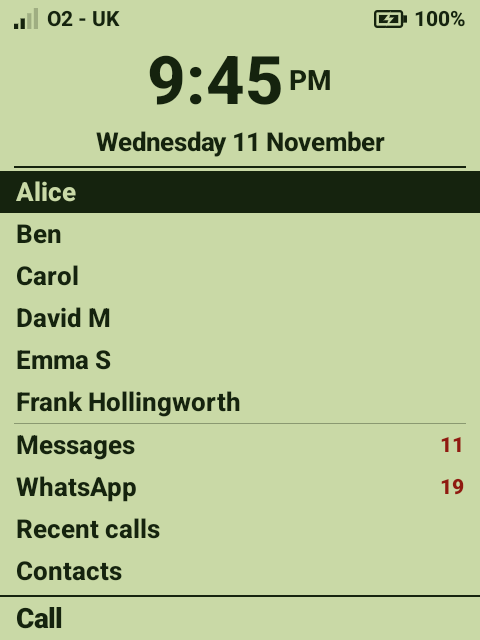
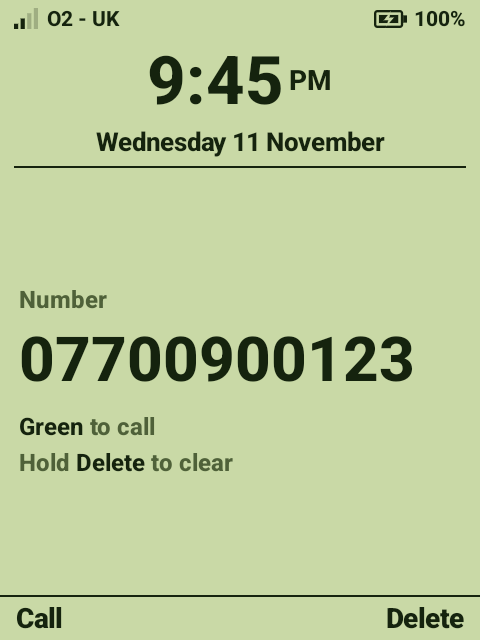

# Doovdroid Launcher

A really simple home screen for Doov keypad Android phones, in the spirit of the old Nokia 3210:
one screen, worked entirely with the keys, nothing to swipe and nothing to get lost in.

<p>
  
  &nbsp;
  
</p>

## What it does

- **One screen.** A big clock, up to 8 people to call, then Messages, WhatsApp, Recent calls and
  Contacts. No pages, no scrolling, and touch is switched off.
- **Keys only.** ▲ ▼ to choose, OK or green to call. Type digits to dial any number.
- **Shows what's new.** Unread texts, unread WhatsApp messages and missed calls, on their rows.
- **Hard to get lost.** Settings, the app store and the notification pull-down are kept out of
  reach, and waking the phone always comes back to this screen.
- **Easy to look after.** A hidden admin menu for the family: choose who is on the screen, open
  Settings.

## Documentation

| Page | What's in it |
|------|--------------|
| [The home screen](docs/home-screen.md) | What's on the screen; calling, dialling and opening things |
| [Keys](docs/keys.md) | What every key does, and this phone's odd ones |
| [Admin menu](docs/admin-menu.md) | The hidden menu for the family |
| [Speed dial](docs/speed-dial.md) | Choosing who is on the home screen |
| [Settings file](docs/settings-file.md) | PIN, screen colours and speed dial as a text file |
| [The guard](docs/guard.md) | How the phone is kept on the simple screen |
| [Installing](docs/installing.md) | Build, install and set up a phone, and how to undo it all |
| [Troubleshooting](docs/troubleshooting.md) | Things that can go wrong and what to do |
| [The phone](docs/device.md) | Notes on the Doov hardware and its quirks |
| [Development](docs/development.md) | Code layout, building, testing safely |

There's also a clickable mockup: open [`docs/mockup.html`](docs/mockup.html) in a browser.

## Quick start

You need the Android SDK, JDK 17 or newer, and `adb`, with the phone plugged in and USB debugging on.

```sh
scripts/deploy.sh        # build and install the launcher
scripts/setup-phone.sh   # make it the home screen and lock the phone down
```

Then open the admin menu on the phone (type `00003210`) and choose **Speed dial** to add people.
[Installing](docs/installing.md) has the details, including how to put the phone back as it was.

## The phone

Built for, and tested on, a Doov keypad phone: MediaTek MT6765, Android 14, 480 × 640 screen, full
hardware keypad (it reports itself as `alps r77`). Other Android 14 keypad phones may well work;
the key quirks in [The phone](docs/device.md) are the things to check.

## Licence

[MIT](LICENSE).
