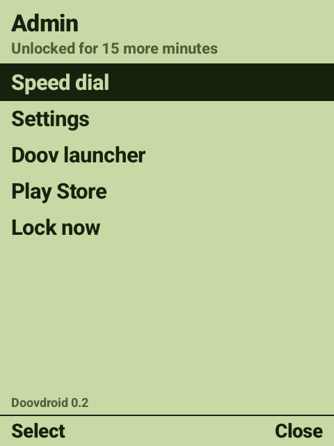

# Admin menu

[← Back to the README](../README.md)

A hidden menu for whoever looks after the phone.

## Opening it

On the home screen, type **`0000` and then the PIN**. The default PIN is `3210`, so: **`00003210`**.
The menu opens as soon as the last digit is typed.

- No real phone number starts with `0000`, so it can't happen by accident.
- `*` and `#` can't be used: this phone turns them into volume keys.
- Change the PIN with `pin=` in the [settings file](settings-file.md) (4 to 12 digits).

## What's in it

| Item | Does |
|------|------|
| **Speed dial** | Choose who is on the home screen, and in what order. See [Speed dial](speed-dial.md) |
| **Settings** | Android's Settings |
| **Doov launcher** | The maker's original launcher, without changing the home screen |
| **Play Store** | For updating WhatsApp (see [Troubleshooting](troubleshooting.md#whatsapp-says-its-out-of-date)) |
| **Lock now** | Lock everything away again straight away |

**▲ ▼** to choose, **OK** or the **left soft key** to select, **right soft key** to close. Touch works
in the admin screens.

## The 15 minutes

Opening the admin menu switches off [the guard](guard.md) for **15 minutes**, so Settings and the
other hidden apps can be used. The menu shows how long is left. **Lock now** ends it early, and it
locks itself when the time is up.

If the time runs out while you're in Settings, you stay there until you leave it or the screen goes
off. Then the phone goes back to the home screen as normal.
