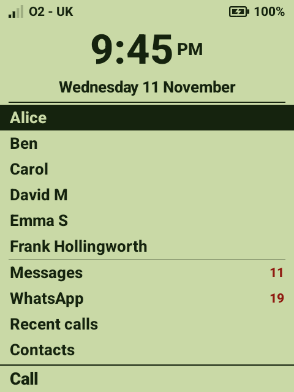
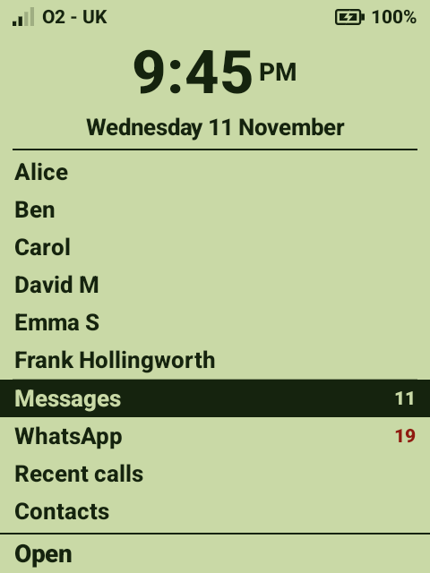
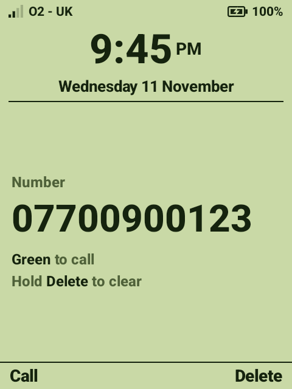

# The home screen

[← Back to the README](../README.md)

  
  &nbsp;
  

Everything is on this one screen. Nothing scrolls and there are no other pages.

From the top:

1. **Signal, network and battery.** A lightning bolt in the battery means it's charging.
2. **The time and date**, large.
3. **The people**: up to 8, in the order chosen in [Speed dial](speed-dial.md).
4. **Messages, WhatsApp, Recent calls, Contacts.** Each shows a count when there's something new.
5. **The soft-key bar.** It says what the two blank keys either side of the D-pad do right now.

## Calling someone

Move the dark bar to their name with **▲ ▼**, then press **OK**, **green** or the **left soft key**
(the bar says *Call*). The phone's own call screen takes over; **red** hangs up.

## Opening Messages, WhatsApp, Recent calls or Contacts

Move to the row and press **OK**, **green** or the **left soft key** (the bar says *Open*). These are
the phone's own apps. The **right soft key** backs out of them, and turning the screen off and on
again always comes back here.

## Dialling a number

Just start typing it. The list is replaced by the number in large digits.

| To | Press |
|----|-------|
| Call it | **Green**, **OK** or the **left soft key** (*Call*) |
| Delete a digit | The **right soft key** (*Delete*) |
| Clear the number | Hold the **right soft key** |
| Type **+** | Hold **0** |

Emergency numbers (999, 112) can't be called directly by an app, so they open the phone's dialler
with the number filled in. Press **green** again there.

`*` and `#` can't be dialled from this screen: on this phone they change the volume (see [Keys](keys.md)).

## The counts

| Row | Shows |
|-----|-------|
| Messages | Text messages not yet read |
| WhatsApp | WhatsApp's own unread count, taken from its notification |
| Recent calls | Missed calls not yet looked at. Opening Recent calls clears it |

## Coming back to this screen

- **Red** turns the screen off (it's the power key). Waking the phone always lands here, unless a
  call is in progress.
- The **right soft key** steps back out of any app.
- Every time the screen comes back, the highlight is on the first person and anything half-typed is
  cleared.

## Things that are deliberately missing

- **Touch.** Taps on this screen do nothing, so a stray finger can't call anyone.
- **Settings, the app store, the notification pull-down.** See [The guard](guard.md). The family gets
  to them through the [Admin menu](admin-menu.md).

## Colours

Three schemes: **pale green LCD** (the default, shown here), **black on white** and **white on
black**. Set with `style=` in the [settings file](settings-file.md).
