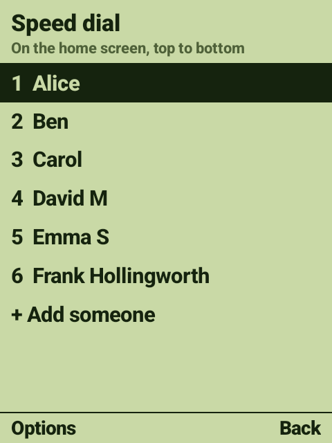
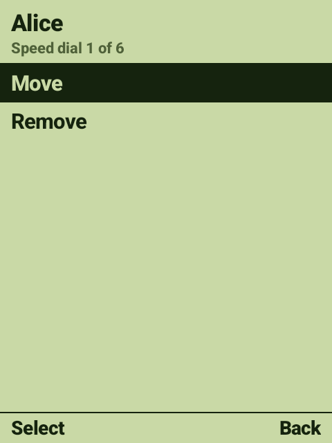
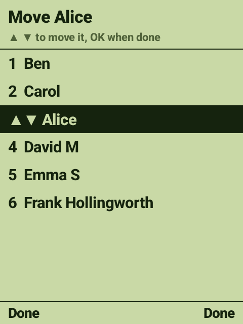

# Speed dial

[← Back to the README](../README.md)

The people on the home screen are chosen in **Admin menu › Speed dial**.

  
  &nbsp;
  
  &nbsp;
  

## The list

The people in the order they appear on the home screen, then **+ Add someone** while there are
fewer than 8.

| To | Do |
|----|----|
| **Add someone** | Choose **+ Add someone**, press **OK**. The phone's contact picker opens (it has search); pick the person |
| **Move someone** | Choose them, **OK** › **Move**. **▲ ▼** shift them; **OK** when done |
| **Remove someone** | Choose them, **OK** › **Remove** |
| **Leave** | **Right soft key** |

Changes are saved straight away and show the next time the home screen appears.

## Good to know

- **Up to 8 people.** The home screen never scrolls, so the names get smaller as the list grows.
  Fewer people, bigger names.
- **Numbers follow the contact.** Only the person's *name* is saved, and their number is looked up
  in Contacts each time. If their number changes in Contacts, speed dial follows. The number used is
  the contact's default, otherwise a mobile, otherwise any.
- **Picking a particular number.** If you pick a number that isn't the one speed dial would choose,
  that number is saved with the name instead.
- **"no number"** next to a name means no contact with exactly that name was found. Rename the
  contact back, or remove and re-add them.
- **No one chosen?** Then the home screen shows the phone's *starred* contacts instead.

The same list can be edited from a computer: see [Settings file](settings-file.md).
